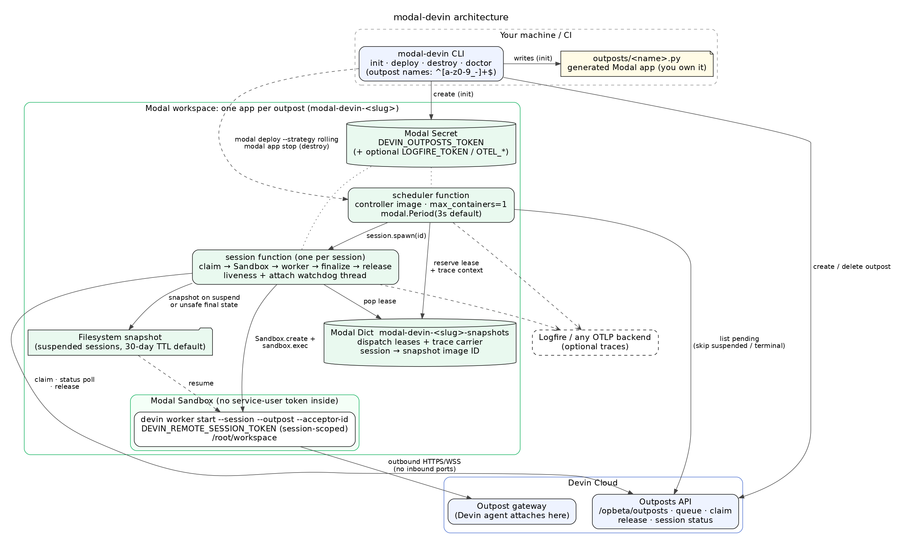

# modal-devin

Run Devin Outposts sessions in isolated [Modal Sandboxes](https://modal.com/docs/guide/sandboxes)
that you configure and control.

## Get started

[Install uv](https://docs.astral.sh/uv/getting-started/installation/) if you do not
already have it, then run the interactive setup wizard:

```bash
uvx modal-devin init
```

The wizard configures Modal if needed, validates the outpost name (lowercase letters,
digits, dashes, and underscores), creates your outpost, stores its Devin credential as a
Modal Secret, generates the Modal application, and offers to deploy it.

Day-to-day commands are `modal-devin deploy` (rolling redeploy), `modal-devin doctor`
(environment check), and `modal-devin destroy` (stops the Modal app and deletes the
outpost, keeping the generated file and Modal Secret).

Read the full documentation at [modal.com/docs/devin](https://modal.com/docs/devin).

## Architecture



A scheduler function on Modal polls the outpost queue and spawns one session function
per pending session. Each session function claims its session, runs the Devin worker in
an isolated Modal Sandbox, watches the session's liveness and attach status, and
releases the claim when the work ends. The Devin service user key stays in the Modal
Secret; the Sandbox only receives a session-scoped connect token. Traces are emitted
through OpenTelemetry/Logfire when configured.

See [How modal-devin works](explanation/architecture.mdx) for details. The diagram
source is [architecture.dot](assets/architecture/architecture.dot) ([SVG](assets/architecture/architecture.svg));
edit it and run `assets/architecture/render.sh` to re-render.

> [!NOTE]
> `modal-devin` is alpha software. Until the first stable release, only the latest
> release on the default branch receives security fixes.

## Development

See [CONTRIBUTING.md](CONTRIBUTING.md) for the development and test workflow. Report
vulnerabilities through [GitHub private vulnerability reporting](https://github.com/aaazzam/modal-devin/security).
