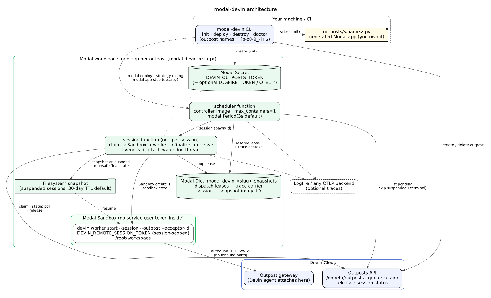

Devin Outposts separates planning from execution. Devin's agent loop remains in
Devin Cloud, while commands, file edits, and repository access happen on compute you
operate.

`modal-devin` supplies the orchestrator for Modal. It connects an outpost to
isolated [Modal Sandboxes](https://modal.com/docs/guide/sandboxes) and manages each
session from startup through cleanup.

The diagram source is [`assets/architecture/architecture.dot`](https://github.com/COG-GTM/modal-devin/blob/main/assets/architecture/architecture.dot).
Edit it and run `assets/architecture/render.sh` (requires Graphviz) to refresh the
PNG and SVG.

## Components

| Component | Where it runs | Responsibility |
| --- | --- | --- |
| `modal-devin` CLI | Your machine or CI | `init`, `deploy`, `destroy`, and `doctor` for generated outpost files |
| Generated outpost file | Your repository | Owns the Modal `App`, Secret, images, function decorators, and schedule |
| `scheduler` function | Modal, controller image | Lists pending sessions and spawns one `session` invocation per session |
| `session` function | Modal, prepared worker image | Claims one session, runs its Sandbox, finalizes, and releases the claim |
| Modal Sandbox | Modal | Runs `devin worker start` in `/root/workspace` |
| Modal Dict `modal-devin-<slug>-snapshots` | Modal | Dispatch leases, trace carriers, and the session-to-snapshot index |
| Devin Outposts API and gateway | Devin Cloud | Queue, claims, session status, and the connection the agent attaches to |

## The orchestrator

The generated Modal application is the orchestrator deployment. It has two functions.

The `scheduler` runs on a `modal.Period` schedule (3 seconds by default) with
`max_containers=1`. Each run lists the outpost's pending sessions, skips sessions
that are suspended or already finished, reserves a short-lived dispatch lease in the
Modal Dict, and calls `session.spawn(session_id)`. It never claims a session.

Each `session` invocation:

1. Pops its dispatch lease and claims the session with a unique acceptor ID. A claim
   conflict means another invocation won, and this one exits quietly.
2. Starts a Sandbox from the session's preserved filesystem snapshot, or from the
   deployed worker image for a new session. Startup waits are bounded by the claim
   deadline.
3. Runs `devin worker start --session ... --outpost ... --acceptor-id ...` inside the
   Sandbox and streams its output to Modal logs, prefixed with the session ID.
4. Runs a liveness and attach watchdog beside the worker (see below).
5. Confirms the final session state, snapshots the filesystem when the session
   suspends or the final state is unsafe, and terminates the Sandbox.
6. Releases the claim, after both success and failure.

Your generated file exposes deployment policy such as images, secrets, compute,
regions, retries, and schedule. The library keeps the Outposts and Sandbox lifecycle
behind the `Worker` API.

## The worker

The Devin worker serves one session. Inside its Sandbox it can run commands, edit
files, use project tools, and reach services allowed by your Modal environment.

The workspace comes from either the current deployed image or a preserved filesystem
from an earlier suspended attempt.

## Session liveness and attach watchdog

While the worker runs, a watchdog thread in the `session` function checks the
session every `status_watchdog_interval_seconds` (10 seconds by default):

- If the session reaches a terminal state or leaves the queue, the watchdog
  terminates the Sandbox instead of letting it idle until the function timeout.
  Three consecutive `suspended` readings count as the session ending.
- If the worker logged its gateway connection but Devin has not attached within
  `session_attach_timeout_seconds` (20 seconds by default), the watchdog terminates
  the Sandbox and the invocation raises `SessionAttachTimeoutError`. The claim is
  released, and the scheduler dispatches a fresh worker. A reconnect restarts the
  clock.

## Trust boundary

The Devin service user key lives only in the Modal Secret attached to the
`scheduler` and `session` functions. Those functions make every Outposts API call:
listing, claiming, status checks, and release.

The key never enters the Sandbox. The worker receives the claim's short-lived,
session-scoped connect token (`DEVIN_REMOTE_SESSION_TOKEN`) and gateway URL, plus an
inert placeholder that satisfies the Devin CLI's token presence check. A compromised
session workload can reach its own session connection, not the outpost queue.

There is no credential proxy or sidecar container. Use a dedicated Enterprise service
user, and separate outposts and credentials when trust requirements differ. See the
[security model](/explanation/security).

## Tracing

The scheduler and session runtimes emit OpenTelemetry spans through Pydantic Logfire.
Each scheduler poll starts a trace. The trace carrier is stored with the dispatch
lease, so the `session` invocation continues the same trace through claim, Sandbox
start, the worker process, finalization, and release. Add `LOGFIRE_TOKEN` to the
Modal Secret to send traces to Logfire, or set `OTEL_EXPORTER_OTLP_ENDPOINT` for
another backend. Without either, no traces leave the container. See
[Configure runtime behavior](/guides/runtime-configuration#trace-sessions-with-opentelemetry).

## Network requirements

Workers need outbound HTTPS access to Devin and run without inbound ports, a public
IP, or a connection initiated from Devin Cloud.

## Operational model

One generated application represents one outpost deployment. Give deployments unique,
durable names so their Modal resources and resumable work remain independent.

- `init` validates the outpost name locally (lowercase letters, digits, dashes, and
  underscores) before it calls the Outposts API, creates the outpost and Modal
  Secret, writes the file, and optionally deploys it.
- `deploy` always uses Modal's rolling strategy, so running sessions finish on the
  previous version.
- `destroy` stops each selected Modal app, then deletes its Devin outpost. It keeps
  the generated file and the Modal Secret.
- `doctor` checks the Modal SDK, Modal token, Secret, and that each outpost file has
  a deployed app.

<Card title="Session lifecycle" icon="route" href="/explanation/session-lifecycle" horizontal>
  See what happens when a session is queued, runs, suspends, completes, or fails.
</Card>
